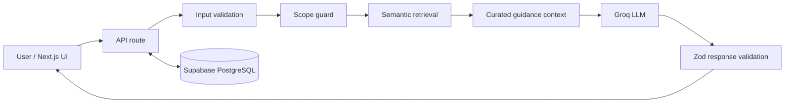

# NutriAI — Evidence-grounded Nutrition Assistant

**A conversation-first AI application that connects nutrition questions with curated dietary guidance.**

[](https://nextjs.org/) [](https://www.typescriptlang.org/) [](https://groq.com/)

**[Explore the live application](https://ai-nutrition-assistant-ten.vercel.app)** · **[Meet the builder](https://github.com/imnashraf)**

## The problem

Nutrition advice online is often hard to trace back to trustworthy guidance. General-purpose chatbots can provide plausible explanations without making their evidentiary basis clear.

NutriAI explores a more accountable interaction: a clean conversational experience supported by a curated nutrition corpus, semantic retrieval, structured AI responses, and explicit scope boundaries.

## What it does

- **Conversational nutrition guidance:** Users ask food and dietary guidance questions through a streamlined chat experience.
- **Retrieval-augmented answers:** Relevant document excerpts are retrieved and supplied as model context when available.
- **Source visibility:** Retrieved source metadata is returned alongside answers for an inspectable evidence trail.
- **Conversation continuity:** Conversations and messages are persisted in Supabase PostgreSQL.
- **Scope control:** Requests outside the supported guidance domain can be declined before model inference.
- **Response validation:** Zod schemas check the structure of generated responses before returning them to the interface.

> **Important:** This is an informational AI project, not a substitute for personalized medical or dietetic advice. Retrieval and validation reduce some errors but do not guarantee factual correctness.

## Architecture



**Core stack:** Next.js 16, React 19, TypeScript, Tailwind CSS, Groq, local embeddings / retrieval, and Supabase PostgreSQL. The repository's actual source and deployment environment are authoritative for the latest integrations.

## Engineering decisions worth examining

| Design choice | Why it matters |
| --- | --- |
| Retrieve context before generation | Helps connect responses to a bounded evidence collection |
| Validate input and model output | Makes API behavior more predictable |
| Refuse disallowed requests upstream | Avoids unnecessary model calls for known out-of-scope prompts |
| Persist conversations | Supports continuity across interactions |
| Keep inference and retrieval behind the server API | Prevents exposing service credentials in client code |

## Explore the project

1. Open the [live demo](https://ai-nutrition-assistant-ten.vercel.app).
2. Ask a general dietary-guidance question, such as *What are common sources of dietary fiber?*
3. Try a follow-up question and inspect any sources returned.
4. Try a question outside the app's nutrition scope to examine the boundaries of the experience.

Live application availability and answers depend on the deployed services and current corpus.

## Run locally

```bash
git clone https://github.com/imnashraf/ai-nutrition-assistant.git
cd ai-nutrition-assistant
npm install
npm run dev
```

Open [http://localhost:3000](http://localhost:3000). Configure the server-side credentials for Groq, Supabase, and any retrieval services used by your environment before testing AI functionality. Never commit API keys or database credentials. This repo does not currently provide a checked-in `.env.example`; consult the server modules to identify the current required variables.

**Available scripts:** `npm run dev`, `npm run lint`, `npm run build`, and `npm run start`.

## Scope and transparency

This repository is a practical applied-AI implementation, not a claim of clinically validated nutrition recommendations. Model accuracy, retrieval coverage, data freshness, and operational performance require ongoing evaluation. Do not treat output formatting validation as proof that every claim is correct.

## About the builder

Built by [Nabil Ashraf](https://github.com/imnashraf), focused on **AI Product Engineering | Agentic AI | RAG Systems | Intelligent Automation**.

Interested in AI products, practical intelligent automation, or engineering collaboration? Connect through [GitHub](https://github.com/imnashraf).
